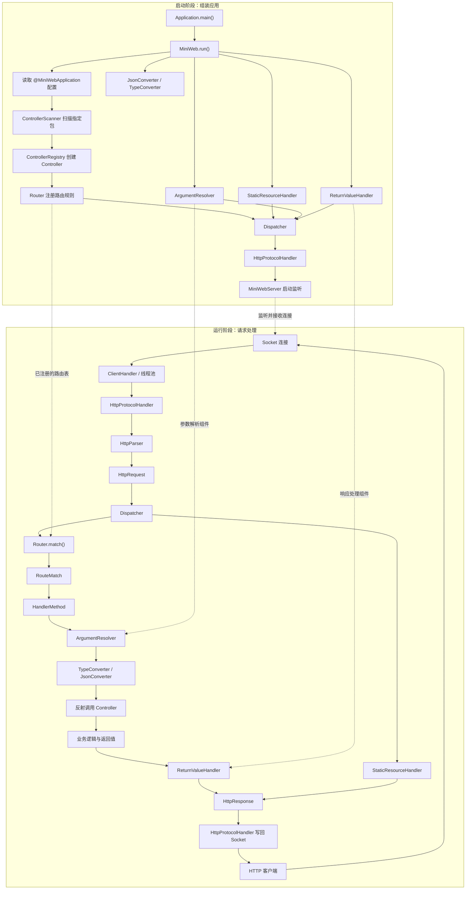
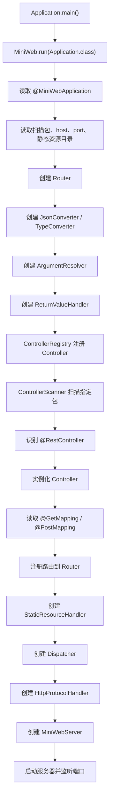
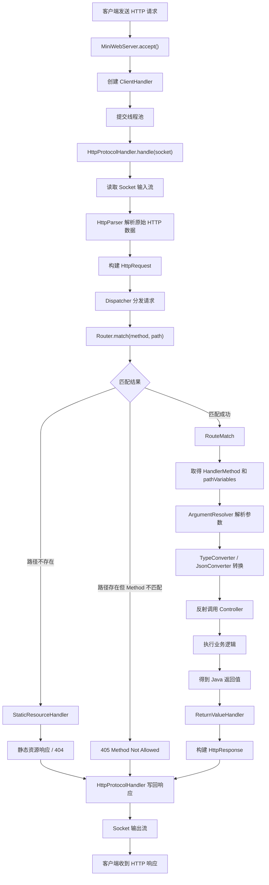
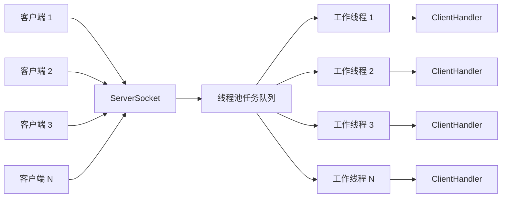

# MiniWeb 项目总结

> 一个基于 Java Socket 实现的轻量级注解式 Web 框架。本文记录 MiniWeb 的整体架构、启动过程、HTTP 请求生命周期、核心组件职责及关键设计思想，作为项目复习和后续维护文档。

## 1. 项目简介

MiniWeb 从底层网络通信出发，逐步实现 HTTP 请求解析、路由匹配、Controller 管理、参数绑定、返回值处理和静态资源访问，提供接近 Spring MVC 的注解式开发体验。

项目的核心目标不是复刻 Spring Boot 的全部功能，而是理解 Web 框架如何把一次网络请求转化为 Controller 方法调用，再把方法返回值转换成 HTTP 响应。

### 技术栈

| 技术 | 用途 |
|---|---|
| Java 21 | 核心开发语言 |
| Java Socket | TCP 网络通信 |
| ExecutorService | 客户端连接并发处理 |
| Maven | 构建与依赖管理 |
| Jackson Databind | JSON 序列化与反序列化 |
| SLF4J | 日志抽象 |
| JUnit 5 | 测试 |

## 2. 整体架构

MiniWeb 可以分为两个阶段：

- **启动阶段**：读取应用配置，扫描 Controller，注册路由，创建各个处理组件并启动服务器。
- **运行阶段**：接收 Socket 连接，解析 HTTP 请求，匹配路由，解析 Controller 参数，执行方法，生成并写回 HTTP 响应。

### 2.1 系统架构图



### 2.2 模块职责

| 模块 / 组件 | 核心职责 | 输入 | 输出 |
|---|---|---|---|
| `MiniWeb` | 应用启动与组件组装 | 应用入口类 | 已启动的应用 |
| `MiniWebServer` | 监听端口、接收连接、管理线程池 | TCP 连接 | 客户端处理任务 |
| `ClientHandler` | 处理单个客户端 Socket 生命周期 | `Socket` | 协议处理结果 |
| `ProtocolHandler` | 定义协议处理抽象 | `Socket` | 协议处理行为 |
| `HttpProtocolHandler` | HTTP 读取、请求处理循环、响应写回 | `Socket` | HTTP 响应数据 |
| `HttpParser` | 解析 HTTP 原始字节 | 输入流 / 原始 HTTP 数据 | `HttpRequest` |
| `HttpRequest` | 封装请求行、请求头、Query、Body | 解析结果 | 结构化请求对象 |
| `Dispatcher` | 组织请求分发 | `HttpRequest` | 路由处理或静态资源处理 |
| `Router` | 根据 Method 和路径匹配路由 | 请求方法、路径 | `RouteMatch` 或匹配结果 |
| `RouteMatch` | 保存匹配到的路由及路径变量 | 路由匹配过程 | 路由处理信息 |
| `HandlerMethod` | 描述并执行 Controller 方法 | Controller、Method、参数 | 方法返回值 |
| `ArgumentResolver` | 解析 Controller 方法参数 | 方法信息、请求、路径变量 | 参数数组 |
| `TypeConverter` | 基础类型转换 | 原始字符串 | Java 基础类型值 |
| `JsonConverter` | JSON 与 Java 对象转换 | JSON 数据 / Java 对象 | Java 对象 / JSON 数据 |
| `ReturnValueHandler` | 处理 Controller 返回值 | Java 返回值 | `HttpResponse` |
| `HttpResponse` | 封装 HTTP 响应 | 状态、响应头、响应体 | 结构化响应对象 |
| `StaticResourceHandler` | 处理静态资源请求 | 请求路径 | 静态资源响应或未命中 |
| `ControllerScanner` | 扫描 Controller 类 | 包名 / Classpath | 类集合 |
| `ControllerRegistry` | 实例化 Controller 并注册映射 | Controller 类 | Controller 实例、路由注册 |

## 3. 应用启动流程

应用通过 `@MiniWebApplication` 标记入口类，并调用 `MiniWeb.run(Application.class)` 启动。



启动阶段完成后，路由表和处理组件已经准备就绪。之后到来的请求可以复用这些组件，不需要每次请求都重新扫描 Controller 或注册路由。

### 3.1 应用入口示例

```java
@MiniWebApplication(
    scanBasePackages = "com.example",
    host = "127.0.0.1",
    port = 8080,
    staticDirectory = "static"
)
public class Application {
    public static void main(String[] args) {
        MiniWeb.run(Application.class);
    }
}
```

`@MiniWebApplication` 已知配置项：

| 属性 | 默认值 | 作用 |
|---|---|---|
| `scanBasePackages` | `""` | Controller 扫描包；为空时默认使用入口类所在包 |
| `host` | `127.0.0.1` | 服务器监听地址 |
| `port` | `8080` | 服务器监听端口 |
| `staticDirectory` | `static` | 静态资源目录 |

## 4. HTTP 请求完整生命周期

假设客户端发送：

```http
GET /users/123?detail=true HTTP/1.1
Host: localhost:8080
Authorization: Bearer token
```

Controller 声明：

```java
@GetMapping("/users/{id}")
public Object getUser(
    @PathVariable("id") Integer id,
    @RequestParam("detail") Boolean detail
) {
    return userService.getUser(id, detail);
}
```

### 4.1 请求处理流程图



### 4.2 各阶段数据转换

整个请求处理过程可以理解为一连串的数据转换：

```text
TCP 连接
  ↓
Socket
  ↓
HTTP 原始字节
  ↓ HttpParser
HttpRequest
  ↓ Dispatcher
路由匹配请求
  ↓ Router
RouteMatch（包含路径变量等匹配信息）
  ↓ ArgumentResolver
Controller 参数数组 Object[]
  ↓ 反射调用
Controller 返回的 Java 对象
  ↓ ReturnValueHandler
HttpResponse
  ↓ HttpProtocolHandler
HTTP 响应字节
  ↓
客户端
```

## 5. 核心数据如何得到

### 5.1 Socket 到 HttpRequest

`MiniWebServer` 通过 `ServerSocket.accept()` 接收连接，得到客户端 `Socket`。`ClientHandler` 将连接处理任务交给线程池，之后由 `HttpProtocolHandler` 读取 Socket 输入流。

`HttpParser` 负责将 HTTP 原始数据解析成结构化的 `HttpRequest`。

| HTTP 原始内容 | 解析后字段 |
|---|---|
| 请求方法 `GET` | `method` |
| 请求路径 `/users/123` | `path` |
| 协议版本 `HTTP/1.1` | `version` |
| 请求头 | `headers` |
| Query 参数 `detail=true` | `queryParameters` |
| 请求体 | `body` |

### 5.2 HttpRequest 到 RouteMatch

`Dispatcher` 将请求交给 `Router`。Router 使用请求方法和路径，与启动阶段注册的路由规则进行匹配。

例如：

```text
已注册：/users/{id}
实际请求：/users/123
```

匹配成功后，路由匹配结果会携带路径变量：

```text
pathVariables = {
    "id": "123"
}
```

这里要区分两个概念：

- **动态路由匹配**：判断 `/users/123` 是否符合 `/users/{id}`。
- **路径变量提取**：从匹配路径中提取 `id=123`，交给后续参数解析器。

### 5.3 RouteMatch 和 HttpRequest 到 Controller 参数

`ArgumentResolver` 根据 Controller 方法参数上的注解，从对应的数据来源提取参数。

| 注解 | 数据来源 | 示例原始值 |
|---|---|---|
| `@PathVariable("id")` | `RouteMatch` 中的路径变量 | `"123"` |
| `@RequestParam("detail")` | `HttpRequest` 的 Query 参数 | `"true"` |
| `@RequestBody` | `HttpRequest` 的 Body | JSON 字节 / 文本 |

拿到原始值后：

- `TypeConverter` 将字符串转换为 `Integer`、`Boolean` 等目标类型。
- `JsonConverter` 负责 JSON 数据与 Java 对象之间的转换。
- `ArgumentResolver` 按照 Controller 方法参数声明的顺序组装参数数组。

例如：

```text
"pathVariables[id]" = "123"
queryParameters[detail] = "true"

       ↓ 类型转换

Integer(123)
Boolean(true)

       ↓ 按方法参数顺序组装

Object[] arguments
```

### 5.4 Controller 返回值到 HttpResponse

`HandlerMethod` 使用反射调用 Controller 方法，得到 Java 返回值。`ReturnValueHandler` 根据返回值处理规则完成序列化和响应构建，最终得到 `HttpResponse`。

最后，`HttpProtocolHandler` 将响应对象写入 Socket 输出流，客户端收到 HTTP 响应。

## 6. 核心 API 速查

### 6.1 应用与 Controller 注解

```java
@MiniWebApplication
@RestController
@GetMapping("/path")
@PostMapping("/path")
@PathVariable("id")
@RequestParam("name")
@RequestBody
```

参数绑定注解的具体属性和支持类型，以项目源码为准。

### 6.2 HttpRequest

Package：`com.miniweb.http`

构造方法：

```java
public HttpRequest(
    HttpMethod method,
    String path,
    String version,
    Map<String, String> headers,
    Map<String, List<String>> queryParameters,
    byte[] body
)
```

公开方法：

```java
public HttpMethod getMethod();
public String getPath();
public String getVersion();
public Map<String, String> getHeaders();
public String getHeader(String name);
public Map<String, List<String>> getQueryParameters();
public List<String> getQueryParameter(String name);
public byte[] getBody();
public String getBodyAsString();
```

注意事项：

- `getPath()` 不包含 Query 字符串。
- 请求头类型为 `Map<String, String>`。
- Query 参数类型为 `Map<String, List<String>>`，支持同名参数多个值。
- `getHeader(name)` 不区分大小写；不存在返回 `null`。
- `getQueryParameter(name)` 不存在时返回空列表。
- `getBodyAsString()` 使用 UTF-8。
- 构造时复制 Map 和 Body；`getBody()` 返回副本。

示例：

```java
String path = request.getPath();
String authorization = request.getHeader("Authorization");
List<String> tags = request.getQueryParameter("tag");
String body = request.getBodyAsString();
```

### 6.3 HttpResponse

Package：`com.miniweb.http`

构造方法：

```java
public HttpResponse(
    String version,
    HttpStatus status,
    Map<String, String> headers,
    byte[] body
)
```

公开方法：

```java
public String getVersion();
public HttpStatus getStatus();
public Map<String, String> getHeaders();
public String getHeader(String name);
public byte[] getBody();
public String getBodyAsString();
```

注意事项：

- `getHeader(name)` 不区分大小写；不存在返回 `null`。
- `getBodyAsString()` 使用 UTF-8。
- 构造时复制响应头 Map 和 Body；`getBody()` 返回副本。
- `HttpResponse` 是 HTTP 响应封装对象；Controller 是否可以直接返回它，取决于 `ReturnValueHandler` 的实际实现。

### 6.4 关键构造关系

```java
new HttpProtocolHandler(dispatcher);

new Dispatcher(router, staticResourceHandler);
```

## 7. HTTP 服务器与并发模型

MiniWeb 使用固定大小线程池处理客户端连接。当前实现配置：

| 配置 | 当前值 |
|---|---:|
| 线程数 | 10 |
| 队列容量 | 100 |
| 拒绝策略 | `AbortPolicy` |
| Socket 读取超时 | 30 秒 |
| 最大请求体 | 10 MB |

简化并发模型：



线程池可以限制并发处理资源，避免无上限创建线程。当工作线程和队列均达到容量限制时，拒绝策略会触发，无法提交处理任务的 Socket 会被关闭。

HTTP Keep-Alive 允许同一个连接上依次处理多个请求。连接生命周期由 HTTP 协议处理逻辑和 Socket 状态共同决定。

## 8. 错误处理与静态资源

### 8.1 路由结果

| 情况 | 处理 |
|---|---|
| 路径匹配且 Method 匹配 | 执行对应 Controller |
| 路径存在但 Method 不匹配 | 返回 405，并提供 `Allow` 信息 |
| Controller 路由未匹配 | 尝试静态资源处理 |
| 静态资源也未命中 | 返回 404 |

请求解析错误、业务执行异常等还需要由对应处理层转换为合适的 HTTP 错误响应。具体错误响应格式和异常捕获策略以源码为准。

### 8.2 静态资源

`StaticResourceHandler` 负责处理静态文件请求。静态资源目录通过 `@MiniWebApplication(staticDirectory = "...")` 配置，默认值为 `static`。

示例目录：

```text
example/
├── src/
└── static/
    ├── index.html
    ├── css/
    │   └── style.css
    └── js/
        └── app.js
```

## 9. 日志设计

MiniWeb 使用 SLF4J 作为日志门面。建议按事件重要程度使用日志级别：

| 级别 | 适用场景 |
|---|---|
| DEBUG | 路由匹配、请求处理节点、Socket 生命周期等调试信息 |
| INFO | 服务器启动、关闭等重要事件 |
| WARN | 可恢复异常、资源拒绝或非预期情况 |
| ERROR | 请求处理失败、服务器关键错误 |

框架依赖 SLF4J API，日志具体输出由应用侧配置的日志实现负责。

## 10. 项目设计中值得记住的原则

1. **Server 不处理业务**：只负责监听连接、接收 Socket 和调度任务。
2. **Parser 不负责路由**：只把 HTTP 原始数据解析成 `HttpRequest`。
3. **Router 不执行 Controller**：只匹配路由并产生匹配结果。
4. **ArgumentResolver 不处理业务**：只从请求和路由结果中提取、转换方法参数。
5. **Controller 不处理 HTTP 底层细节**：专注业务逻辑。
6. **ReturnValueHandler 不处理业务**：只把 Java 返回值转换为 HTTP 响应。
7. **ProtocolHandler 不依赖 Controller**：负责协议层的读写和连接上的请求处理。

这些边界使框架各模块职责清晰，也让后续扩展更容易定位修改范围。

## 11. 当前功能范围与后续方向

### 已实现的核心能力

- Java Socket HTTP 服务器。
- 固定线程池并发处理客户端连接。
- HTTP/1.0、HTTP/1.1 基本处理。
- Content-Length、Keep-Alive、Socket 超时和请求体大小限制。
- HTTP 请求解析与 `HttpRequest` 封装。
- HTTP 响应封装与写回。
- GET、POST 注解式路由。
- 精确路径和动态路径匹配。
- `@PathVariable`、`@RequestParam`、`@RequestBody` 参数绑定能力。
- Controller 扫描、实例化与路由注册。
- 参数类型转换与 JSON 转换基础设施。
- Controller 返回值处理。
- 静态资源处理。
- SLF4J 日志接口。

### 可以继续扩展的方向

- 完善统一异常处理。
- 增加拦截器或过滤器机制。
- 增加依赖注入容器。
- 增加文件上传与下载。
- 增加 HTTPS 支持。
- 完善服务器优雅关闭和生命周期管理。
- 增加更完整的集成测试与压力测试。
- 发布稳定版本到远程 Maven 仓库。

## 12. 总结

MiniWeb 的核心是一条完整的 Web 请求处理管线：

```text
Socket
  → HTTP Parser
  → HttpRequest
  → Dispatcher
  → Router
  → RouteMatch
  → ArgumentResolver
  → Controller
  → ReturnValueHandler
  → HttpResponse
  → Socket
```

启动阶段负责创建组件、扫描 Controller 和注册路由；运行阶段负责接收连接、解析请求、匹配路由、绑定参数、执行 Controller，并将返回值转换为 HTTP 响应。

通过这个项目，完整实践了从底层 TCP Socket 通信，到 HTTP 协议处理，再到注解式 Web MVC 框架的核心设计过程。
