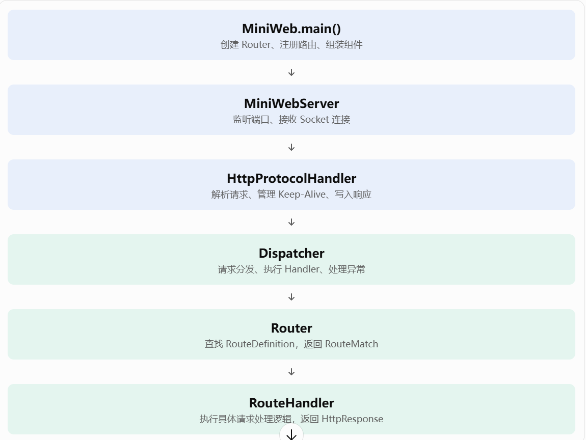

## 第三阶段
### 需求描述
在第二阶段，我们已经实现Http协议，能够实现客户端发http请求，服务器解析Http请求并且封装为HttpRequest,将数据写回到Response。并且我们在代码中留了插桩点。这一阶段我们就要来实现插桩点，如何将具体的URL分发，实现URL的路由，动态匹配，并且正确返回数据，并且想清楚怎么样留接口能够让下一阶段实现用户写注解就能注册路由
下面是验收清单：
#### 1. 路由注册
- [ ] 支持 GET、POST、PUT、DELETE 四种 HTTP 方法
- [ ] 支持注册 URL 与对应的请求处理器
- [ ] 支持同一路径注册不同 HTTP Method
- [ ] 检测相同 Method 和 Path 的重复注册
- [ ] 检测动态路由之间的冲突

#### 2. URL 匹配
- [ ] 支持 URL 精确匹配
- [ ] 支持动态路径匹配，例如 /user/{id}
- [ ] 支持提取动态路径参数
- [ ] 支持多个动态路径参数，例如 /user/{id}/order/{orderId}
- [ ] 精确路由优先于动态路由
- [ ] 路径段数量不一致时不能匹配
- [ ] 正确处理路径尾部斜杠等边界情况

#### 3. 请求方法匹配
- [ ] 根据 HTTP Method 和 URL 共同匹配路由
- [ ] 相同 URL 支持不同 HTTP Method
- [ ] URL 存在但 Method 不匹配时返回 405
- [ ] URL 不存在时返回 404
- [ ] 405 响应正确设置 Allow 响应头

#### 4. 请求分发
- [ ] Dispatcher 能够调用 Router 获取匹配结果
- [ ] Dispatcher 能够调用对应的请求处理器
- [ ] 请求处理器能够获取 HttpRequest
- [ ] 请求处理器能够获取动态路径参数
- [ ] 请求处理器能够返回 HttpResponse
- [ ] 未匹配路由时正确返回错误响应
- [ ] 处理器执行异常时能够返回 500

#### 5. HTTP 服务集成
- [ ] HttpProtocolHandler 成功接入 Dispatcher
- [ ] 不同 URL 能够返回不同的响应内容
- [ ] GET、POST、PUT、DELETE 请求均能正常分发
- [ ] 保持 HTTP Keep-Alive 功能正常
- [ ] 多客户端并发请求时路由分发正常

#### 6. 阶段验收
- [ ] 不同 URL 能够匹配不同处理器
- [ ] 动态路径参数能够正确提取
- [ ] HTTP Method 能够正确区分
- [ ] 不存在的 URL 返回 404
- [ ] 请求方法不匹配返回 405
- [ ] 重复路由注册能够被检测
- [ ] curl 能够正常测试所有路由
- [ ] JUnit 5 集成测试全部通过

### 开始开发
第三阶段首先设计统一的 `RouteHandler` 接口，明确路由处理器的输入与输出；随后设计 `RouteDefinition` 和 `RouteMatch`，分别封装路由定义和匹配结果；接着实现 `Router`，完成路由注册、HTTP Method 匹配、URL 精确匹配、动态路径匹配、参数提取、路由冲突检测以及 404/405 判断；然后实现 `Dispatcher`，负责调用 Router 获取匹配结果、执行对应的 Handler 并生成 HttpResponse；最后将 Dispatcher 接入 `HttpProtocolHandler`，替换第二阶段预留的测试插桩点，通过 JUnit 5、curl 和 Python 并发测试完成集成验收。本阶段只实现手动注册路由和请求分发，为下一阶段预留注解注册接口，不涉及 Controller、注解扫描、反射调用和参数绑定。

#### 1.实现RouterHandler
RouteHandler 是路由系统统一的请求处理器接口，用于定义路由匹配成功后具体由谁处理请求。接口接收完整的 HttpRequest 和动态路径参数 Map<String, String>，使处理器能够获取请求信息和 Router 提取的路径参数，完成相应的处理逻辑后返回 HttpResponse。这样 Router 只负责路由匹配，Handler 负责请求处理，Dispatcher 负责组织和调用整个流程。同时使用 @FunctionalInterface，允许通过 Lambda 表达式创建处理器，方便第三阶段手动注册路由，也为后续扩展提供统一的接口。

#### 2.实现RouterDefinition
RouteDefinition 用于封装一条完整的路由定义，将 HTTP 请求方法、路由路径和对应的请求处理器统一保存到一个对象中。这样做是为了避免 Router 分别管理路由的各项信息，使每条路由规则都具有独立、完整的数据结构，方便后续进行路由注册、匹配和冲突检测。实现时，我们将 method、path 和 handler 定义为 private final 字段，通过构造方法完成初始化，并提供对应的 Getter。由于路由注册后不需要频繁修改这些信息，因此采用不可变字段设计，保证路由定义的稳定性，也让后续 Router 的实现更加清晰。

#### 3.实现RouterMatch
RouteMatch 用于封装 Router 完成路由匹配后产生的结果，并将其传递给 Dispatcher。Router 只负责判断请求应该匹配哪条路由，不直接执行 Handler，也不负责生成 HTTP 响应。因此，我们需要一个统一的数据对象来保存匹配结果。这里使用 MatchStatus 枚举表示三种状态：MATCHED（匹配成功）、NOT_FOUND（路径不存在）和 METHOD_NOT_ALLOWED（请求方法不允许）。匹配成功时保存对应的 RouteDefinition 和动态路径参数；请求方法不允许时保存该路径支持的 HTTP 方法，方便 Dispatcher 后续生成对应的 HTTP 响应。通过这种方式，Router 和 Dispatcher 之间只需要通过 RouteMatch 传递结果，不需要相互了解对方的内部实现。

#### 4.实现Router
Router 是路由系统的核心组件，负责路由的注册、管理和匹配。首先，通过注册方法将 HTTP Method、URL Path 和对应的 RouteHandler 封装为 RouteDefinition，并保存到内部集合中；当收到 HTTP 请求时，Router 根据请求方法和路径查找对应路由，支持精确路径匹配和动态路径匹配，并提取动态路径参数。为了保证路由规则的正确性，还需要在注册时进行冲突检测，同时区分路径不存在和请求方法不允许两种情况。最终，Router 将匹配结果封装为 RouteMatch 返回给 Dispatcher，由 Dispatcher 决定后续的请求处理流程。

#### 5.实现Dispatcher
Dispatcher 是路由系统的请求分发组件，负责协调 Router 和 RouteHandler，完成请求的最终分发。它首先调用 Router 获取 RouteMatch，根据匹配状态执行不同操作：匹配成功时获取对应的 RouteHandler 并执行请求处理逻辑；路径不存在时生成 404 响应；请求方法不允许时生成 405 响应，并通过 Allow 响应头告知客户端允许的请求方法。同时，Dispatcher 还需要捕获 Handler 执行过程中产生的异常，记录错误日志并返回 500 响应。通过 Dispatcher 将路由匹配与请求处理分离，使 Router 专注于路由管理，Handler 专注于业务处理，而 Dispatcher 负责协调整个请求分发流程。

#### 6.流程图




### 3. 测试

启动：

```
mvn compile exec:java "-Dexec.mainClass=com.miniweb.MiniWeb"
```

分别打开 PowerShell 测试：

测试 1：精确路由

```
curl.exe -i http://127.0.0.1:8080/hello
```

预期响应：

```
HTTP/1.1 200 OK

Hello MiniWeb!
```

测试 2：动态路由

```
curl.exe -i http://127.0.0.1:8080/user/100
```

预期响应：

```
HTTP/1.1 200 OK

User ID: 100
```

测试 3：POST 请求

```
curl.exe -i -X POST http://127.0.0.1:8080/user -d "Tom"
```

预期响应：

```
HTTP/1.1 200 OK

User created: Tom
```

测试 4：404

```
curl.exe -i http://127.0.0.1:8080/notfound
```

测试 5：405

```
curl.exe -i -X DELETE http://127.0.0.1:8080/hello
```

预期包含：

```
HTTP/1.1 405 Method Not Allowed
Allow: GET
```
