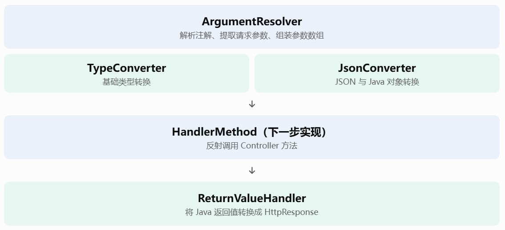

## 第四阶段
### 需求描述
在第三阶段我们实现了Dispather和Router实现了根据URL地址路由到对应路径Handler，对于用户来说，现在只需要router.add()就可以实现路由，关键是这对用户是并不友好的，用户使用起来并不方便，我们学习Spring的机制，实现@Controller等等注解，让用户编写路由更加的方便

下面是验收清单：

- [ ] 支持使用 `@RestController` 定义 Controller。
- [ ] 支持使用 `@GetMapping`、`@PostMapping` 定义接口。
- [ ] 支持自动扫描并注册 Controller。
- [ ] 支持 `@PathVariable` 获取 URL 路径参数。
- [ ] 支持 `@RequestParam` 获取 URL 查询参数。
- [ ] 支持 `@RequestBody` 自动接收并转换 JSON 请求体。
- [ ] 支持自动完成请求参数类型转换。
- [ ] 支持自动调用 Controller 对应方法。
- [ ] 支持自动处理 Controller 方法返回值。
- [ ] 支持通过浏览器和 curl 完成 GET、POST 请求测试。
- [ ] 支持处理 Controller 执行异常。

### 开始开发

第四阶段主要是为了让 MiniWeb 从一个需要手动注册路由的 HTTP 框架，逐渐变成一个能够通过注解开发 Web 接口的框架。整体思路是：用户编写普通 Java Controller 类，并使用 `@RestController` 标记控制器，使用 `@GetMapping`、`@PostMapping` 等注解声明接口；MiniWeb 启动时自动扫描指定包下的 Controller，通过反射读取类和方法上的注解，将 Controller 中的方法注册到第三阶段已经实现的 Router 中。当浏览器发送请求时，Router 找到对应的路由，框架再通过反射获取目标方法的参数信息，根据 `@PathVariable`、`@RequestParam`、`@RequestBody` 等注解从 HttpRequest 中提取数据，完成类型转换后调用 Controller 方法，最后将方法的返回值转换成 HttpResponse 返回给客户端。

例如，用户只需要编写：

```
@RestController
public class UserController {

    @GetMapping("/user/{id}")
    public User getUser(
            @PathVariable("id") int id,
            @RequestParam("name") String name
    ) {
        return new User(id, name);
    }
}
```

当用户请求 `/user/100?name=Tom` 时，MiniWeb 自动提取 `id=100` 和 `name=Tom`，转换成对应的 Java 参数，通过反射调用 `getUser(100, "Tom")`，再将返回的 User 对象转换为 HTTP 响应。整个过程对业务开发者透明，用户不再需要手动操作 Router 和 RouteHandler。
#### 1. 创建注解定义

1. ResController

`@RestController` 用于标记一个 Java 类是 MiniWeb 的 Controller。它本身不负责创建对象、扫描类或注册路由，只提供一个标识，让后续的 Controller 扫描器能够识别哪些类需要作为控制器处理。我们使用 `@Target(ElementType.TYPE)` 限制它只能标记在类上，使用 `@Retention(RetentionPolicy.RUNTIME)` 保证程序运行时仍然可以通过反射读取该注解。

2. GetMapping.

`@GetMapping` 用于标记 Controller 中处理 GET 请求的方法，并通过注解属性指定 URL 路径。例如 `@GetMapping("/user")` 表示该方法负责处理 GET `/user` 请求。它只能标记在方法上，因此使用 `@Target(ElementType.METHOD)`；同时需要在运行时通过反射读取路径，因此使用 `@Retention(RetentionPolicy.RUNTIME)`。注解的 `value` 属性用于保存用户声明的 URL 路径。

3. PostMapping

`@PostMapping` 与 `@GetMapping` 的设计完全类似，用于标记 Controller 中处理 POST 请求的方法，并通过 `value` 属性指定 URL 路径。例如 `@PostMapping("/user")` 表示该方法负责处理 POST `/user` 请求。路径参数也可以正常使用，例如 `/user/{id}`，具体匹配仍然交给第三阶段的 Router 处理。

4. PathVariable

设计思路：用于将 URL 路径中的动态参数绑定到 Controller 方法的形参上。例如 `/user/{id}` 中的 `id` 可以通过 `@PathVariable("id")` 获取。注解只能用于方法参数，并且需要在运行时读取。

5. RequestParam

设计思路：用于获取 URL 中的 Query 参数。例如请求 `/user?name=Tom`，可以通过 `@RequestParam("name")` 获取 `Tom`。后续参数解析器会负责从 `HttpRequest` 中提取参数并转换类型。

6. RequestBody

设计思路：用于将 HTTP 请求体绑定到 Controller 方法参数上。例如客户端提交 JSON 数据，框架后续会读取请求体，通过 JSON 反序列化转换成对应的 Java 对象，再传递给 Controller 方法。

#### 2.实现扫描Controller包

我们先解决一个问题：用户编写了 `UserController`，并使用 `@RestController` 标记，但是 MiniWeb 怎么知道这个类的存在？

Java 本身不会自动发现项目中所有带有某个注解的类，因此我们需要自己实现扫描机制。首先由用户在启动 MiniWeb 时指定一个扫描包，例如 `com.example.controller`，框架根据这个包名找到对应的 `.class` 文件，遍历其中的类，再通过反射检查类上是否存在 `@RestController` 注解。如果存在，就将这个类识别为 Controller，交给后续的注册机制处理。

#### 3.实现参数转化的能力

这一步我们先把 Controller 请求处理所依赖的参数转换能力准备好，暂时不涉及 Controller 实例化和路由注册。整体设计是：Controller 方法的参数可能来自 URL 路径、Query 查询参数或 JSON 请求体，但这些数据最初都是字符串或字节数组，不能直接传给 Java 方法，因此需要先建立统一的转换机制。我们使用 `TypeConverter` 处理 Java 基础类型转换，使用 Jackson 封装 JSON 序列化与反序列化；再由 `ArgumentResolver` 根据 `@PathVariable`、`@RequestParam`、`@RequestBody` 三种注解，从 `HttpRequest` 中提取数据并调用转换器，按照方法参数顺序组装参数数组；最后由 `ReturnValueHandler` 处理 Controller 方法的返回值，将字符串、基础类型和 Java 对象转换成 `HttpResponse`。这样后续 `HandlerMethod` 只需要协调参数解析、反射调用和返回值处理，不必关心具体转换细节。

| 文件                      | 为什么需要                                   | 具体实现                                                     |
| ------------------------- | -------------------------------------------- | ------------------------------------------------------------ |
| `TypeConverter.java`      | HTTP 参数通常是字符串，Java 方法需要具体类型 | 支持 String、int、long、double、float、boolean、short、byte、char 及其包装类型 |
| `JsonConverter.java`      | JSON 请求体和 Java 对象之间需要转换          | 封装 Jackson 的序列化、反序列化                              |
| `ArgumentResolver.java`   | Controller 方法的参数来源不同                | 根据三种参数注解提取数据，调用转换器，组装参数数组           |
| `ReturnValueHandler.java` | Controller 返回值不能直接作为 HTTP 响应发送  | 将 String、基础类型和对象转换为 HttpResponse                 |

##### 3.1 TypeConverter.java

为什么做： `@PathVariable("id")` 和 `@RequestParam("age")` 获取到的原始数据都是字符串。例如 URL 中的 `id=100`，最终需要转换为 Java 的 `int`。如果把类型转换逻辑写在 `ArgumentResolver` 中，会让参数解析和类型转换耦合在一起，因此单独抽取一个转换器。

怎么做： 提供统一的 `convert(String value, Class<?> targetType)` 方法，根据目标类型选择对应的转换逻辑。暂时不支持复杂泛型、数组和自定义类型，这些不属于当前阶段的基础类型转换范围。

##### 3.2 JsonConverter.java

为什么做： `@RequestBody` 接收的是 HTTP 请求体中的 JSON 字节数据，而 Controller 方法通常希望直接接收 Java 对象。例如请求体是 `{"id":100,"name":"Tom"}`，我们希望最终得到 `User` 对象，而不是让每个 Controller 自己解析 JSON。

怎么做： 使用 Jackson 的 `ObjectMapper`，封装 `fromJson()` 和 `toJson()` 两个方法。这样整个 MiniWeb 只需要通过这个类完成 JSON 转换，后续想更换 JSON 库也只需要修改这一层。

##### 3.3ArgumentResolver.java

为什么做： Controller 方法可能同时具有多个参数，而且参数来源不同。例如：

```
@GetMapping("/user/{id}")
public User getUser(
        @PathVariable("id") int id,
        @RequestParam("name") String name
) {
    return new User(id, name);
}
```

如果每个 Controller 方法都手动从 `HttpRequest` 获取参数，就失去了注解机制的意义。因此我们需要统一的参数解析器。

怎么做： 提供 `resolveArguments(Method method, HttpRequest request, Map<String, String> pathVariables)` 方法，遍历反射得到的方法参数，检查每个参数上的注解：

- `@PathVariable`：从 Router 提供的 `pathVariables` 中获取。
- `@RequestParam`：从 `HttpRequest.getQueryParameter()` 中获取。
- `@RequestBody`：从 `HttpRequest.getBodyAsString()` 获取 JSON，再调用 `JsonConverter`。

最后通过 `TypeConverter` 完成基础类型转换，并按照参数原本的顺序返回 `Object[]`

##### 3.4ReturnValueHandler.java

为什么做： Java Controller 方法返回的是 Java 对象，而 HTTP 协议需要的是状态行、响应头和响应体。例如返回 `User` 对象时，不能直接将对象写入 Socket，需要先序列化为 JSON。

怎么做： 统一处理返回值：

- `String`：按照 `text/plain` 返回。
- `null`：返回 204 No Content。
- 其他对象：调用 `JsonConverter.toJson()`，按照 `application/json` 返回。
- 底层统一创建 `HttpResponse`，由已有的 `HttpProtocolHandler` 负责写入 Socket。

##### 流程图



#### 4.包装方法

实现 `HandlerMethod.java`。前面我们已经完成了参数解析器和返回值处理器，但它们目前是独立的组件，还没有真正串联起来。`HandlerMethod` 就是这条调用链的协调者：它持有 Controller 实例和对应的 `Method`，收到 `HttpRequest` 和 Router 提取的路径参数后，先调用 `ArgumentResolver` 生成方法参数数组，再通过 `Method.invoke()` 执行 Controller 方法，最后将执行结果交给 `ReturnValueHandler` 转换成 `HttpResponse`。这样，后续 `ControllerRegistry` 只需要把 Controller 方法包装成 `HandlerMethod`，再注册到 Router 即可

#### 5.实现路由的注册

职责： 负责 Controller 的实例化和路由注册。它不负责参数解析，也不直接执行 Controller 方法；这些工作交给已经实现的 `ArgumentResolver`、`HandlerMethod` 和 `ReturnValueHandler`。这样注册层只关心一件事：把带有映射注解的方法转换成 Router 能识别的 `RouteHandler`。

实现步骤：

1. 根据包名创建 `ControllerScanner`，获取所有 Controller 类。
2. 为每个 Controller 创建一个实例。
3. 遍历类中的方法，识别 `@GetMapping` 和 `@PostMapping`。
4. 创建 `HandlerMethod`，将 Controller 实例、Method 和参数处理组件交给它。
5. 调用 `router.addRoute()` 完成注册。

### 开始测试与验收

